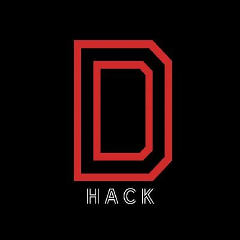
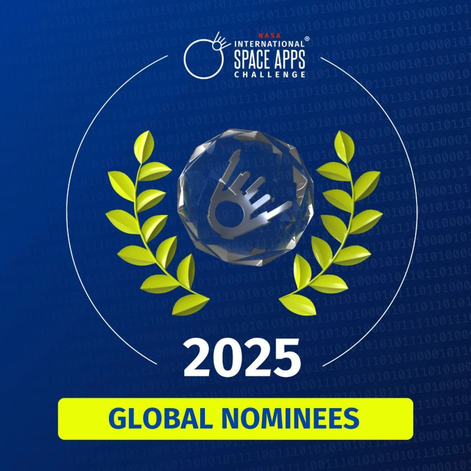
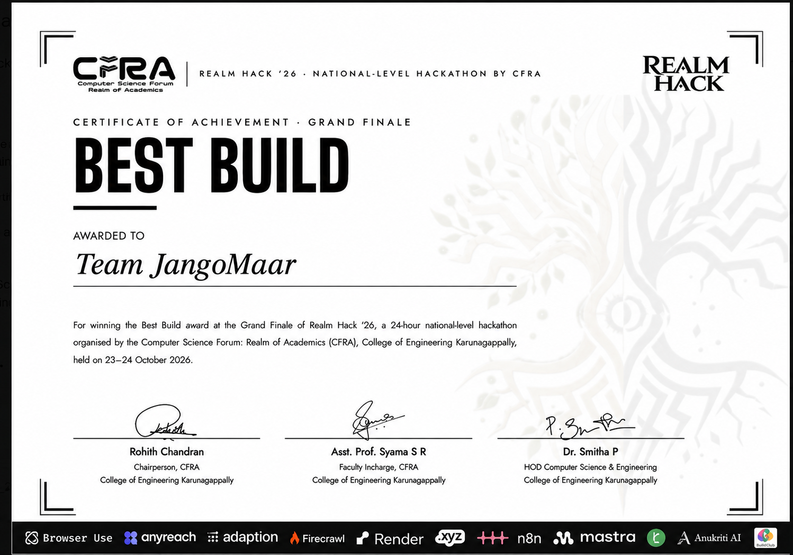

  
    

  # D-HACK1

  **Built at hackathons. Shipped as real products.**

  
  
  
  

   

  
  
  
  
  
  
  
  
  
  

---

### ▸ About Us
We're a small team of builders who meet at hackathons, pick the hardest problem on the table, and ship something that actually works in 24–48 hours. D-Hack1 is where those builds live on afterward — a portfolio of hackathon projects, MVPs, and technical prototypes spanning banking security, AI/data products, renewable energy, public safety, and mobile utilities. Whatever the domain, the goal is the same: find a real problem and build a solution technical enough to survive contact with reality — from on-device edge AI to massive gigapixel data pipelines.

---

### ▸ Hall of Fame

<table width="100%">
<tr>
<td align="center" width="240"></td>
<td valign="middle" style="padding-left:24px">

 

  

**Project:** [N-Large](https://github.com/D-Hack1/Nlarge)

 

**Team:** [ebinthomas06](https://github.com/ebinthomas06) · [AadiBolics](https://github.com/AadiBolics) · [nivednarayan](https://github.com/nivednarayan) · [sanjay-was-taken](https://github.com/sanjay-was-taken) · [jaith-krishh](https://github.com/jaith-krishh) · [JXTDEVELOPER](https://github.com/JXTDEVELOPER)

  

</td>
</tr>
<tr><td colspan="2"> </td></tr>
<tr>
<td align="center" width="240"></td>
<td valign="middle" style="padding-left:24px">

 

  

**Project:** [KooliKanakku](https://github.com/D-Hack1/KooliKanakku)

 

**Team (JangoMaar):** [ebinthomas06](https://github.com/ebinthomas06) · [AadiBolics](https://github.com/AadiBolics) · [nivednarayan](https://github.com/nivednarayan) · [AbhiKamp](https://github.com/AbhiKamp)

  

</td>
</tr>
</table>

---

### ▸ Flagship Projects

 

### 01 · [N-Large](https://github.com/D-Hack1/Nlarge)

*"Google Maps for Space" — visualizing massive, gigapixel-scale astronomical data.*
N-Large solves the problem of rendering 500MB+ raw `.fits` or `.tif` space images in a standard web browser without crashing. It pre-processes images into a pyramid of optimized tiles and dynamically serves them based on user zoom level and coordinates.

-3776AB?style=flat-square&logo=python&logoColor=white)

**Team:** [ebinthomas06](https://github.com/ebinthomas06) · [AadiBolics](https://github.com/AadiBolics) · [nivednarayan](https://github.com/nivednarayan) · [sanjay-was-taken](https://github.com/sanjay-was-taken) · [jaith-krishh](https://github.com/jaith-krishh) · [JXTDEVELOPER](https://github.com/JXTDEVELOPER)

<b>View N-Large Architecture Details</b>

*   **Data Processing Pipeline:** Custom Python script (`generate_tiles.py`) chops massive images into 256x256 tiles across multiple zoom levels, overlays PostgreSQL DB labels, and uploads to GCS.
*   **Backend:** FastAPI acts as a bridge, proxying image tiles from GCS to the frontend and fetching dynamic configuration.
*   **Frontend:** React + OpenSeadragon seamlessly renders the high-res zoomable images by requesting only visible tiles as the user pans and zooms.

 

---

 

### 02 · [KooliKanakku](https://github.com/D-Hack1/KooliKanakku)

*Fair pay, worked out together — on-device AI for home cleaning estimates.*
An offline-first Android application that helps home-cleaning workers and homeowners agree on fair pricing. Point the phone at a room; the app measures it via sensors, spots clutter/grime using on-device YOLO models, and calculates time and pay.

%20YOLO-FF6F00?style=flat-square&logo=tensorflow&logoColor=white)

**Team (JangoMaar):** [ebinthomas06](https://github.com/ebinthomas06) *(Ebin Thomas)* · [AadiBolics](https://github.com/AadiBolics) *(Aadinadhan A R)* · [nivednarayan](https://github.com/nivednarayan) *(Nived Narayan)* · [AbhiKamp](https://github.com/AbhiKamp) *(Abhinav S)*

<b>View KooliKanakku Architecture Details</b>

*   **Pipeline:** Camera/Sensors -> YOLO Object Detection -> Stain Analysis -> Task Mapper -> Pricing Engine -> PDF Export.
*   **Privacy-First:** The estimate and evidence engine runs fully on-device. No network code is required for the core app (works in Airplane Mode).
*   **Features:** Tamper-evident evidence hashing, English/Malayalam UI, and an optional Supabase-powered "Find a worker" layer.

 

---

 

### 03 · [Aegis](https://github.com/D-Hack1/Aegis)

*Passive AI/ML network threat detection.*
A highly complex, passive network monitoring platform that combines network telemetry, machine learning, and real-time streaming to detect threats without introducing an active control path.

<b>View Aegis Architecture Details</b>

*   **Pipeline:** Zeek Telemetry -> Feature Engineering -> Kafka Staging -> ML Inference (XGBoost/Isolation Forest) -> Elasticsearch -> React Dashboard.
*   **Capabilities:** Detects SYN/UDP floods, C2 beaconing, DGA, and exfiltration. Uses SHAP for explainable detection (converting features into human-readable evidence).
*   **Data Flow:** Designed for isolated Docker environments simulating real attack and benign traffic scenarios.

---

### ▸ Complete Project Portfolio

Beyond our flagship applications, our organization houses several robust MVPs, grouped by domain:

<table width="100%">
<tr>
<td width="50%" valign="top">

*   [**InvisiKey**](#) — Flutter banking solution using rhythm-based behavioral authentication and ML for OTP-free transactions.
*   [**Sentry**](#) — Python-based incident detection, alerting, and event processing engine.
*   [**SEE**](#) — Full-stack web platform for governance and public monitoring (SIH 2025).

</td>
<td width="50%" valign="top">

*   [**Gene-Expression-Explorer**](#) — Streamlit/Flask web app for biomedical data exploration with automated ML analysis on public datasets.
*   [**Adobe Series**](#) *(Adobe, adobe_a1, adobe_1b)* — Iterative Python data pipelines and model experimentation suites for analytics challenges.

</td>
</tr>
<tr><td colspan="2"> </td></tr>
<tr>
<td width="50%" valign="top">

*   [**SolarWatts**](#) — Flutter mobile app for renewable energy monitoring and consumption optimization.
*   [**sharewatts**](#) — Dart/Flutter application for peer-to-peer solar sharing and smart-grid community engagement.

</td>
<td width="50%" valign="top">

*   [**SIGNOPSIS & SIGNOPSIS-FINAL**](#) — Front-end heavy coding/education portals ("CODE KALARI") backed by Python.
*   [**Arivu**](#) — TypeScript-based knowledge and education SaaS dashboard.
*   [**Canara_Backend** & **bajaj**](#) — Django/FastAPI backend foundations for financial platforms and domain-specific automation.

</td>
</tr>
</table>

---

  <i>Building intelligent interfaces, secure architectures, and data-driven solutions.</i>

